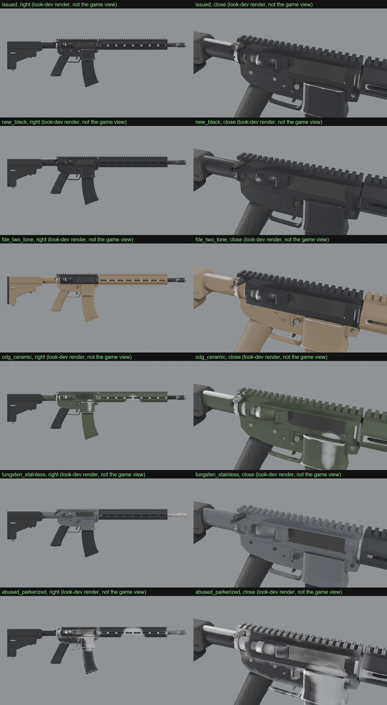

<h1 align="center">Coating Lab</h1>

<!-- mcp-name: io.github.hpdkhoa/coatinglab-mcp -->

<p align="center"><strong>Real surface finishes for game gun models, worn where use wears a gun.</strong></p>

<p align="center">
  <a href="LICENSE"></a>
  <a href="pyproject.toml"></a>
  <a href="https://pypi.org/project/coatinglab-mcp/"></a>
  <a href="https://registry.modelcontextprotocol.io/v0/servers?search=coatinglab-mcp"></a>
  <a href="https://www.blender.org/download/"></a>
  <a href="#tools"></a>
  <a href="src/coatinglab/data/finishes.json"></a>
</p>

An MCP server that gives game gun models real surface finishes, worn where use wears a gun.

- **A finish library with sources.** Anodized aluminium, manganese and zinc phosphate, blued and nitrided steel,
  ceramic coatings (FDE, OD green, tungsten, graphite, coyote), stainless, polymer, rubber, brass, copper, lead,
  walnut. Each is a physically based value (linear colour, metallic, roughness) with what shows when it wears through
  and the sources of its numbers. Values reasoned from descriptions are marked as estimates.
- **Coating variants.** A spec puts a finish on each material slot of a model, in as many variants as you want (an
  issued rifle, a two-tone FDE build, an abused one), each at a wear level: new, issued, worn or abused.
- **Wear from evidence, baked once.** In Blender, into the model's vertex colours: exposed edges, where the hands work
  the gun (its grip, the support hand, the controls), where parts slide (a magazine in its well, a stock on its tube),
  and dirt where the surface is occluded and round the muzzle and the port. Every variant reads the same masks, so a
  new variant costs nothing.
- **Checks.** Every finish against the rules physically based rendering rests on. Every variant's worn share against
  its level, and no wear inside corners.
- **One formula everywhere.** The checks, the look-dev renders and an engine's material compute wear the same way
  (`coat.py`), so what passes is what the player sees.



Model Lab ([modellab-mcp](https://github.com/hpdkhoa/modellab-mcp)) builds give their own slots (upper, lower,
barrel and more), marks and parts: `spec_for_modellab` makes a coating spec from a build in one call.

## Install

Python 3.10 or later and [Blender](https://www.blender.org/download/) 4.2 or later.

    pip install coatinglab-mcp

```json
{"mcpServers": {"coatinglab": {"command": "coatinglab-mcp"}}}
```

| Setting | Meaning |
|---|---|
| `COATINGLAB_OUT` | The only folder Coating Lab writes to. `~/.coatinglab` by default. |
| `COATINGLAB_BLENDER` | Blender, when it is not on the PATH or in the usual install folder. |
| `COATINGLAB_LIBRARY` | A finishes JSON of your own, merged over the built-in library. |
| `COATINGLAB_WAIT_FOR` | Process names that hold the machine. A bake waits for none of them to run. |

## Tools

| Tool | What it does |
|---|---|
| `list_finishes`, `read_finish` | The library, and one finish with its notes and sources. |
| `check_library`, `check_finish` | The library, or a finish of your own, against the physical rules. |
| `list_wear_levels`, `list_templates` | The wear levels, and the ready variant sets. |
| `spec_for_modellab` | A coating spec for a Model Lab build. |
| `validate_spec` | A spec's problems: a slot without a finish, a finish on the wrong material. |
| `bake` | Bakes the wear masks into a copy of the model. |
| `check_coating` | Each variant's wear against its level, and wear kept out of corners. |
| `render_variants` | Look-dev renders and a sheet. |
| `engine_params` | A variant's values by slot for an engine material. |

## The masks and the formula

The bake writes the vertex colour `Col`:

| Channel | Meaning |
|---|---|
| R | Edge: 1 on flat ground, 0 on a sharp exposed edge |
| G | Handling: 1 where the hands work the gun |
| B | Rub: 1 along the lines parts slide on |
| A | Dirt: 1 where the surface is occluded, and round the muzzle and the port |

An engine's material follows the formula in `src/coatinglab/coat.py`. A wear level is a threshold: the higher the
level, the weaker the mask that already wears through. A grunge texture breaks wear up but never makes wear.

## What is estimated

- Every roughness value. No source maps a finish's surface to a rendering roughness.
- The colours of the anodized, phosphate, blued, nitrided and most ceramic finishes. The standards set processes, not
  colours. OD green and coyote come from FED-STD-595 colour numbers.
- The wear amounts. Sources say where guns wear, not how fast. Each level is set so Model Lab's M4A1 lands in the
  middle of its band.
- A hand's zone is a sphere: on a round handguard the support hand's wear reaches its top as well as its underside.

## License

MIT
